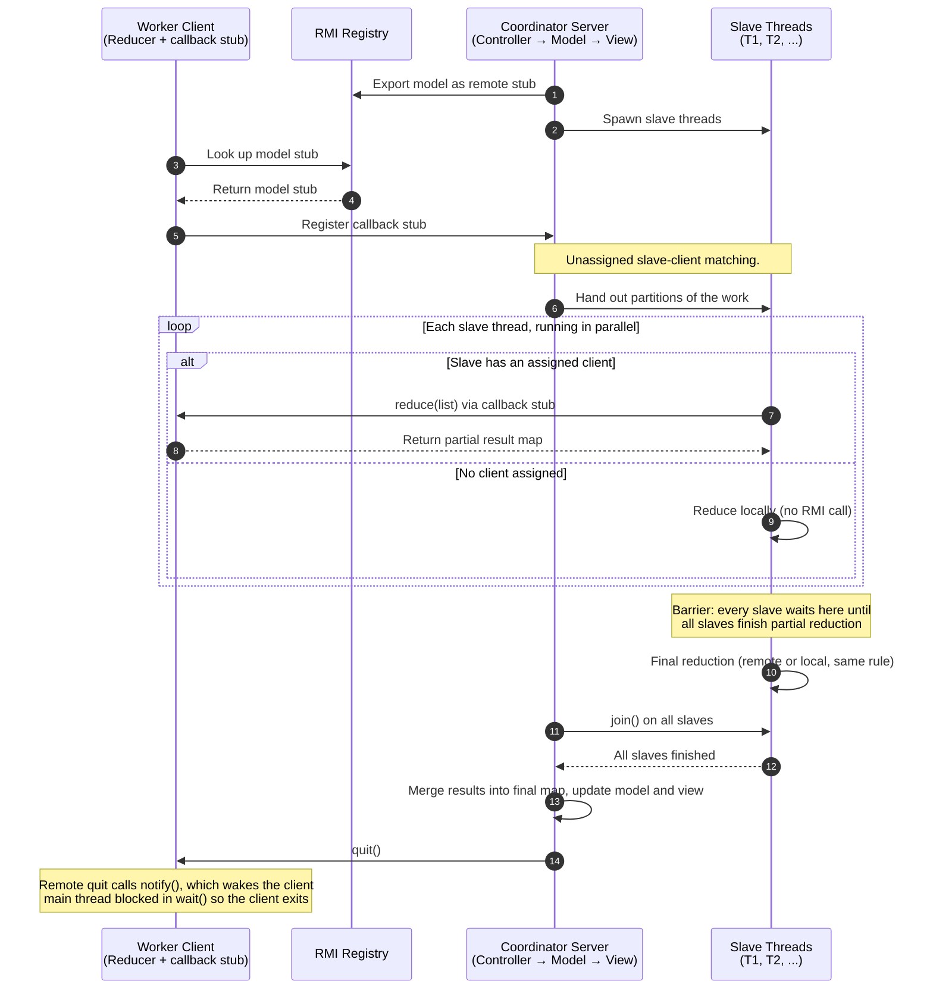

# Distributed MapReduce in Java

A Java implementation of a **master–worker MapReduce system** that extends multithreaded processing across multiple operating-system processes using **Java Remote Method Invocation (RMI)**. A server coordinates the MVC application and its slave threads, while client processes provide reduction services to the slave threads assigned to them.

The interesting part is not just splitting work across threads: the project also handles **dynamic client registration, worker matching, remote callbacks, serializable data transfer, synchronization, and coordinated shutdown**.

## Architecture

The server exports its model, creates local slave threads, accepts client proxies dynmically at runtime, and delegates reduction to that client when a slave is assigned one.

*The server keeps the overall MapReduce workflow. A client is a remote worker for one server-side slave thread; it does not run the entire application. A slave without an assigned client reduces its data locally.*

[//]: # (## How It Works)

[//]: # ()
[//]: # (### 1. The server publishes its model)

[//]: # ()
[//]: # (The server starts an **RMI Registry inside the server process** using `LocateRegistry.createRegistry&#40;...&#41;` and exports its remote model under a name. This lets clients look up the server model without requiring a separate registry process.)

[//]: # ()
[//]: # (The server retains the application's MVC structure: the controller accepts user input, the model coordinates the computation and registered clients, and the view presents results.)

[//]: # ()
[//]: # (### 2. The server creates slave threads)

[//]: # ()
[//]: # (The user configures the number of slave threads. Each slave handles a portion of the work, as in the original multithreaded MapReduce design. The model tracks slave runnables that do not yet have a client.)

[//]: # ()
[//]: # (### 3. Clients register dynamically)

[//]: # ()
[//]: # (Each client process looks up the server model through the RMI Registry and calls a remote registration method, passing a **remote client proxy**. The client does not publish its own proxy in the RMI Registry: the client initiates contact with the server, and the server learns about that client through the registration call.)

[//]: # ()
[//]: # (Registration and thread creation can happen in either order. To handle both cases, the model keeps stacks of unassigned slave runnables and client objects. Its matching routine pairs the most recently added unmatched slave and client, removes both from their stacks, and repeats while both stacks contain entries. The matching routine is invoked when a client registers **and** after the server has created the full set of slave runnables. This prevents the model from leaving both an unassigned client and an unassigned slave waiting at the same time.)

[//]: # ()
[//]: # (### 4. Reduction can run locally or remotely)

[//]: # ()
[//]: # (When a slave receives work:)

[//]: # ()
[//]: # (- **Assigned slave:** sends its list of key-value objects to its client proxy using an RMI call. The client runs the shared reducer implementation and returns the result map.)

[//]: # (- **Unassigned slave:** runs the reducer locally, without a remote call.)

[//]: # ()
[//]: # (The client performs reduction only. Partitioning, worker coordination, subsequent reduction steps, and incorporation of results into the final map remain part of the server-side workflow. Depending on the stage, an assigned slave can make remote callbacks for partial as well as final reduction work.)

[//]: # ()
[//]: # (### 5. Serializable objects cross the RMI boundary)

[//]: # ()
[//]: # (Remote method arguments and return values cross a process boundary. The key-value type therefore needs to support Java serialization by implementing `Serializable` through its interface or class hierarchy. The lists and maps used for the transfer contain serializable values, and remote interfaces must account for RMI's `RemoteException`.)

[//]: # ()
[//]: # (### 6. The server can shut clients down)

[//]: # ()
[//]: # (A client exposes a remote `quit&#40;&#41;` operation. Its main thread waits on the client object, while the remote quit callback uses synchronized notification to wake that thread so it can exit. The server model calls `quit&#40;&#41;` on the registered clients and terminates the server-side application as part of coordinated shutdown.)

## Concurrency and Coordination

The project brings together **thread-level parallelism** and **process-level distribution**. These mechanisms solve different coordination problems:

- **Dynamic slave/client matching:** safely connects local worker threads to registered remote reduction services, including when clients register before or after the server creates its workers.
- **Monitor synchronization with `wait()` / `notify()`:** supports the client's lifecycle. A client main thread can remain alive while idle and then be released by the remote quit callback.
- **Slave worker threads:** divide and process work concurrently inside the server process.
- **Barrier synchronization:** coordinates phase boundaries in the multithreaded MapReduce workflow so that the slave threads wait for all other slaves to finish their partial reduction before proceeding for final reduction.
- **Thread joining (`join()`):** Makes the main thread wait until all the work (partial reduction, partitioning, and final reduction) has finished  proceeding with work that depends on those workers being finished.

## Design Patterns and Technical Concepts

- **Master–worker:** the server coordinates the overall computation and its slave threads.
- **Model–View–Controller (MVC):** separates input/control, computation state, and result presentation.
- **Remote proxies and interfaces:** clients look up the server model, then register a remote client proxy for callbacks.
- **Factory-based reducer reuse:** server-side and client-side reductions share the reducer logic obtained through the reducer factory.
- **Multithreading and synchronization:** parallel slave workers, barrier-style phase coordination, thread joining, and monitor signalling.
- **Inter-process communication:** Java RMI, remote method calls, and `RemoteException` handling.
- **Serialization:** transfers key-value lists and map results between JVM processes.
- **Local fallback:** preserves progress when a slave has no assigned client.
- **Distributed lifecycle management:** client registration, matching, and coordinated quit behavior.

## Running the Application

### Requirements

- **Eclipse Temurin JDK 11.0.12**
- **`Comp533All.jar`** available on the project's build path/classpath
- The supplied project archive must be **unzipped into the `src/` folder** before running the application

### Running the project

1. Configure the JDK and add `Comp533All.jar` to the project's build path/classpath.
2. Run ``TokenServer.main``. The server creates the RMI Registry.
4. Run ``TokenClient.main`` for as many client reduction service providers you'd like to add to the project at runtime as individual processes. Each client looks up the remote model and registers its proxy.
5. Follow the server console prompts to configure the slave-thread count and submit input for the selected workload.
6. Use the server's quit command to trigger shutdown of the registered clients and server.

The exact launcher class depends on the selected workload (token counting, integer summation, or Facebook mutual friends). No separate RMI Registry process is required for this design.

## What This Project Demonstrates

This project shows my mastery in working with distributed systems by simulating step by step how to turn a single threaded, StandAloneMapReduce into a DistributedMapReduce application. The biggest challenge is not to create and use threads because that is just like creating and driving cars but the more important and grateful skill I have developed is to learn how to coordinate multithread applications to ensure no concurrency issues occur during runtime and extend that to multiprocess consistency. In techincal terms, I implemented Thread(s) <=> Process(es) coordination, dynamically using a custom matcher that matches local workers with remote services, transfer serializable data across processes (server <=> thread), and manage an proper shutdown. Additionally, the Model View Controller, and Factory patterns allow for this project to be extended with little changes for other developers.
